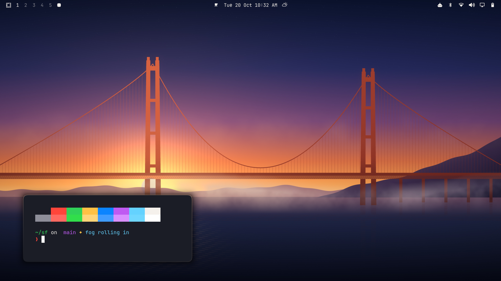

# Golden Gate — an Omarchy theme

The look of **macOS 27 Golden Gate** in dark mode, for [Omarchy](https://omarchy.org).
Built on [Cupertino](https://github.com/pavandot/omarchy-cupertino-theme), retuned for
Golden Gate's indigo wallpaper and its crisper Liquid Glass.



- **Apple dark-mode system colours** with the default system blue accent `#0a84ff`; increased-contrast variants for the bright colours
- **Indigo-tinted window greys** (`#1c1b24`), the way macOS tints windows from the Golden Gate wallpaper
- **Menu bar with no background**: the bar's text sits straight on the wallpaper, as it does on macOS 27
- **Frosted, indigo-tinted glass** for menus, launcher, notifications and popovers. It is less see-through than Tahoe's, with a brighter specular top-left edge
- **macOS-style menus**: the selected row is solid system blue with white text, and the dim behind menus is light, like Spotlight
- **Control Center-style bar dropdowns** (Wi-Fi, Bluetooth, sound, battery, display, calendar): chosen options and slider tracks use a light graphite pill, as in macOS dark mode; blue is kept for focus rings
- **T3 Code** palette (`t3code.json`): graphite sidebar and composer with the indigo cast, a grey pill for the current thread like a macOS sidebar, system blue only for primary actions. Omarchy's generated T3 theme sets 24 of T3's ~60 colours and leaves the rest navy-tinted from the accent; this one sets them all
- **Browser** (`chromium.theme`): Chromium, Chrome, Brave and Edge get neutral graphite toolbars with a faint cool tint, like Safari and Chrome in macOS dark mode. Chromium boosts the saturation of whatever colour it's given, so the theme's own `#1c1b24` would turn the toolbar violet; this gives it a near-grey `#1d1d22` instead
- **Liquid Glass** (optional, one command): frosted blur, a darker edge shadow for separation, 1px specular borders and Golden Gate's tighter, uniform 12px squircle corners
- **Yaru-blue** icons, indigo keyboard backlight
- **Original wallpaper** in the Golden Gate style: layered indigo sheets with hairline luminous edges. It is generated by `extras/make-wallpaper.py`
- **Apple's own wallpapers on request**: Golden Gate Dark and the Golden Gate Bridge photo, with `extras/get-apple-wallpapers.sh`

## Install

```bash
omarchy theme install https://github.com/pavandot/omarchy-golden-gate-theme
```

### Enable Liquid Glass (recommended)

Themes installed from git can't ship Hyprland config, so the glass blur, shadows,
1px borders and rounded corners come as a one-time opt-in:

```bash
~/.config/omarchy/themes/golden-gate/extras/install-glass.sh
```

This copies `extras/golden-gate-glass.lua` to `~/.config/hypr/` and adds
`require("hypr.golden-gate-glass")` to `~/.config/hypr/hyprland.lua`. It stays active
across theme changes. To turn it off, delete that line.

### Use Apple's Golden Gate wallpapers (optional)

Apple's wallpapers are Apple's artwork, so this repo doesn't include them. This script
downloads them to your machine (from the [512 Pixels](https://512pixels.net/2026/07/golden-gate-bridge-wallpaper/) archive)
into `~/.config/omarchy/backgrounds/golden-gate/`. It then switches to Golden Gate Dark:

```bash
~/.config/omarchy/themes/golden-gate/extras/get-apple-wallpapers.sh
```

Cycle wallpapers with `omarchy theme bg next`.

## Files

| File | Purpose |
|------|---------|
| `colors.toml` | Palette and window border colours; Omarchy generates terminal, editor and app themes from it |
| `shell.*.toml` | Bar, menu, launcher, popups, tooltips, notifications, lock screen, password prompt, controls |
| `t3code.json` | Full T3 Code palette (Omarchy syncs it to T3 Code on theme switch) |
| `chromium.theme` | Browser toolbar colour for Chromium-family browsers |
| `icons.theme` | Yaru-blue icons |
| `keyboard.rgb` | Keyboard backlight colour (supported laptops) |
| `backgrounds/` | Original wallpaper |
| `extras/` | Liquid Glass module and installer, Apple wallpaper fetcher, wallpaper generator |

## Tuning

- Glass opacity: change `background-alpha` in `shell.menu.toml`, `shell.launcher.toml`,
  `shell.popups.toml` and `shell.notifications.toml`. The default is 0.7; lower values are clearer and higher values more tinted, like macOS 27's Liquid Glass slider
- Menu bar background: raise `background-alpha` in `shell.bar.toml` (macOS "Show menu bar background")
- Frost: `blur.size` / `blur.passes` in `~/.config/hypr/golden-gate-glass.lua`
- Re-apply after editing theme files: `omarchy theme set golden-gate`

## Wallpaper

```bash
python3 -I extras/make-wallpaper.py backgrounds/golden-gate-indigo.jpg
```

Not affiliated with Apple. macOS, Liquid Glass and the Golden Gate wallpapers are
trademarks and works of Apple Inc.

## License

MIT (does not cover Apple's wallpapers, which the fetch script downloads separately)
